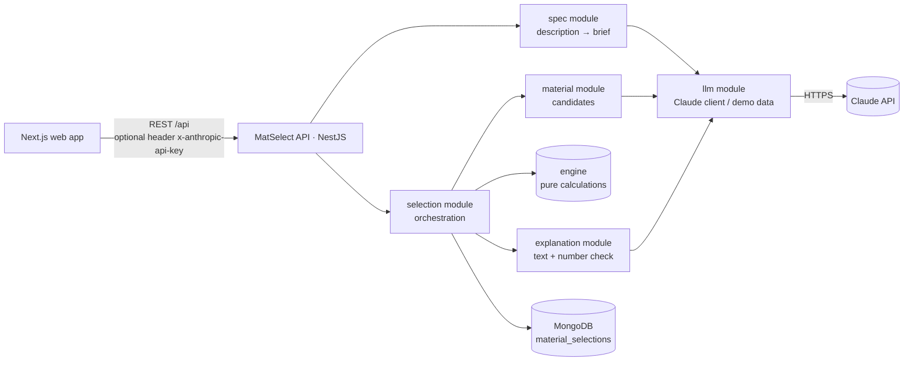
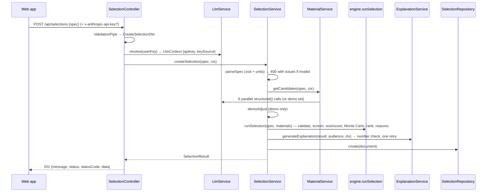

# MatSelect API — how the backend works

The **MatSelect API** turns "what I want to build" into a ranked, explained list of materials. It is a NestJS 11 service with MongoDB (Mongoose).
- feature modules in `src/core/<feature>`, each with a controller, service, Swagger file, DTOs, repository and schema;
- shared pieces in `src/common`;
- one response envelope;
- one global exception filter.

The single most important rule: **Claude never decides which materials fit or in what order.** Claude reads descriptions, proposes candidate materials with property *ranges*, and writes explanations. Fit, sizing and ranking are pure, unit-tested TypeScript in `src/engine/`. Every number in an explanation is checked against the calculation before it is shown.

---

## Contents

1. [Architecture](#1-architecture)
2. [Running it](#2-running-it)
3. [Folder layout](#3-folder-layout)
4. [Request lifecycle](#4-request-lifecycle)
5. [Claude keys: server key, user key, demo data](#5-claude-keys-server-key-user-key-demo-data)
6. [The domain model](#6-the-domain-model)
7. [Module by module](#7-module-by-module)
8. [The engine in detail](#8-the-engine-in-detail)
9. [Claude integration](#9-claude-integration)
10. [Demo (mock) mode](#10-demo-mock-mode)
11. [The explanation number check](#11-the-explanation-number-check)
12. [Persistence](#12-persistence)
13. [API reference](#13-api-reference)
14. [Responses and errors](#14-responses-and-errors)
15. [Configuration](#15-configuration)
16. [Logging, Swagger and rate limiting](#16-logging-swagger-and-rate-limiting)
17. [Testing](#17-testing)
18. [How to change things](#18-how-to-change-things)
19. [Troubleshooting](#19-troubleshooting)

---

## 1. Architecture



| Layer | Where | Responsibility |
|---|---|---|
| HTTP | `*.controller.ts` | Routes, DTO validation, resolving which Claude key to use, wrapping responses with `AppResponse.success` |
| Orchestration | `*.service.ts` | Business flow: what to call, in which order, what to save |
| AI | `core/llm` | Talking to Claude (prompts, output schemas, retries, error mapping) and the demo data used without a key |
| Calculation | `src/engine` | Plausibility checks, screening, material indices, sizing, Monte Carlo, ranking, reasons. No NestJS, no I/O, no AI |
| Data | `repository/`, `schema/` | Mongoose models through `BaseRepository<T>` |

---

## 2. Running it

Requirements: Node.js 20+ and MongoDB on `127.0.0.1:27017`. Run these from the project root:

```bash
npm run setup
```

```bash
npm run dev
```

Or run the API on its own, from `api/`:

```bash
npm run start:dev
```

- API: `http://localhost:4000/api`
- Swagger docs: `http://localhost:4000/api-docs`
- Logs: `api/logs/matselect-api-YYYY-MM-DD.log`

There is no Docker. The app runs natively.

---

## 3. Folder layout

```
api/
├── src/
│   ├── main.ts                      bootstrap: global filter, ValidationPipe, /api prefix, CORS, Swagger
│   ├── app.module.ts                Config, Mongoose, Throttler, Logging + feature modules, HttpLogger middleware
│   ├── app.controller.ts            GET /health, GET /meta
│   ├── app.service.ts
│   ├── common/
│   │   ├── appResponse.parser.ts    AppResponse.success / AppResponse.error, AppException
│   │   ├── baseRepository.repository.ts   generic Mongoose repository
│   │   ├── constants/configs.constant.ts  defaults, header name, fallback-capable models
│   │   ├── domain/domain.types.ts   ★ the domain model (zod): DesignSpec, Material, SelectionResult…
│   │   ├── filters/globalFilter.filters.ts   AllGlobalExceptionsFilter
│   │   ├── interface/main.interface.ts       AppErr, KeySource, LlmContextI
│   │   ├── logging/                 AppLoggerService (winston, daily files) + global LoggingModule
│   │   ├── middleware/httpLogger.middleware.ts
│   │   └── util/                    zodParse (400 with issues), parseSpec / assertUnits
│   ├── core/
│   │   ├── llm/                     Claude client + prompts + output schemas + demo data
│   │   │   ├── llm.service.ts       key resolution, structured()/text(), verifyKey(), error mapping
│   │   │   ├── prompts/llm.prompts.ts
│   │   │   ├── outputs/llm.outputs.ts   JSON Schemas Claude must follow + zod validators
│   │   │   ├── interface/llm.interface.ts
│   │   │   └── mock/                mock.data.ts (extraction, explanations, demoAdjust), mock.materials.ts
│   │   ├── spec/                    POST /specs/extract
│   │   ├── material/                candidate materials (Claude per family, or demo)
│   │   ├── explanation/             explanation + number check
│   │   ├── selection/               POST/GET /selections, explain; schema, repository, grounding util
│   │   └── apiKey/                  POST /api-key/verify
│   └── engine/                      ★ pure calculations (see §8)
│       ├── units.ts  physics.ts  validate.ts  pipeline.ts  random.ts  labels.ts  environments.ts
│       └── engine.spec.ts
├── test/selection.e2e-spec.ts       HTTP tests (real AppModule, throwaway Mongo DB, stubbed Claude)
└── scripts/migrate-legacy-selections.js
```

Imports use absolute `src/...` paths. Jest maps them with `moduleNameMapper`.

---

## 4. Request lifecycle

What happens on `POST /api/selections` (the main endpoint):



Step by step:

1. **`HttpLogger`** records method, URL, status, size and time. It never logs headers, because they may carry an API key.
2. **`ThrottlerGuard`** applies the per-IP rate limit (default 30 requests/minute; GET endpoints are exempt).
3. **`ValidationPipe({ whitelist: true })`** validates the DTO (`CreateSelectionDto` only checks that `spec` is an object).
4. **The controller** reads the optional `x-anthropic-api-key` header and asks `LlmService.resolve()` which key this request uses (§5).
5. **`parseSpec`** validates the brief against the zod `DesignSpec`, applying defaults and checking cross-field rules and units. On failure it returns 400 with `issues: [{ path, message }]` before any money is spent on Claude.
6. **`MaterialService.getCandidates`** gets candidates. With a key it makes one Claude call per family, all six in parallel. A failed family is skipped with a warning; if every family fails the request returns 502. Without a key it uses the demo set.
7. **`demoAdjust`** (demo mode only) maps user-typed environments onto built-in ones and drops custom properties the demo data cannot check. It adds a note for each change.
8. **`runSelection`** (the engine) does all the deciding: plausibility, screening, sizing or index scoring, Monte Carlo, ranking and code-generated reasons.
9. **`ExplanationService`** writes the explanation for the chosen audience (Claude or template) and checks every number in it. If Claude fails, a templated summary is used, so the calculation is still delivered.
10. **`SelectionRepository.create`** saves the document. The response is the full `SelectionResult`.

With Claude, the timing is roughly: candidates 60–75 s (six calls in parallel), engine under 100 ms, explanation 10–15 s.

---

## 5. Claude keys: server key, user key, demo data

`LlmService.resolve(userKey)` decides which key a request uses:

| Situation | Key used | `keySource` | `dataSource` |
|---|---|---|---|
| `ANTHROPIC_API_KEY` set in `api/.env` | server key (any user key is ignored) | `server` | `llm` |
| No server key, header `x-anthropic-api-key: sk-ant-…` sent | the user's key, for this request only | `user` | `llm` |
| No usable key at all | none — built-in demo data | `none` | `mock` |
| `LLM_PROVIDER=mock` | none (forces demo data, e.g. for demos and tests) | `none` | `mock` |

The result is an `LlmContextI` (`{ apiKey, keySource }`). It is passed explicitly into every service method that may call Claude (`extractSpec`, `getCandidates`, `generateExplanation`, `explainSelection`). Nothing request-specific is stored on singletons.

How user keys are handled:
- **Never stored or logged.** A key is used for the request it arrives with. `LlmService` keeps an LRU of at most 20 Anthropic client instances, keyed by a SHA-256 of the key, purely to reuse HTTP connections.
- **Shape-checked first.** Only `sk-ant-…` values are accepted; anything else is treated as "no key".
- **Checked for free.** `POST /api/api-key/verify` calls `models.retrieve`, a metadata call that uses no tokens. The web app calls it before saving a key in the browser.
- **A rejected user key returns 401** (403 if the key cannot use the model), so the web app can open the key dialog. A rejected *server* key returns 502, because it is an operator problem.
- **CORS** allows only `WEB_ORIGIN`, the `content-type` header and the key header.

`GET /api/health` reports `serverHasKey` and `acceptsUserKey` so the web app can show the right badge ("Claude connected", "Using your Claude key" or "Demo data · Add API key").

---

## 6. The domain model

`src/common/domain/domain.types.ts` is the single source of truth. It holds zod schemas plus their inferred types, and `web/lib/types.ts` mirrors the types.

### `DesignSpec` — the brief

| Group | Fields |
|---|---|
| What it is | `title`, `function` (one sentence), `component`, `audience` |
| Goal | `objective` (`min_mass` = best performance / lightest, `min_cost` = value / cheapest), `criteria` (stiffness, strength) |
| Load case (structural parts only) | `load`, `length`, `maxDeflection`, `maxTwistDeg`, `support`, `endCondition`, `section`, `sectionWidth`, `tubeRatio` |
| General parts | `customProperties` (e.g. friction coefficient), `propertyLimits` (min/max on any property), `customObjective` (index to maximise) |
| Context | `environment`, `customEnvironments`, `tempRangeC`, `requiredProcesses`, `mustHave`, `excludeFamilies`, `maxPricePerKg`, `budgetPerPart` |
| Safety | `safetyClass` (`general` 1.5, `carries_people` 2.5, `lifting` 3), `safetyFactor` (override) |
| Traceability | `assumptions` (every default applied, shown to the user), `sourceText` |

The `component` field decides how the part is handled:
- `beam`, `tie`, `column` and `shaft` can be **sized** when a load and a length are given;
- `spring`, `hinge`, `insulation` and `thermal_shock` have textbook indices;
- `custom` is any other part, chosen by its properties: brake pad, heat sink, blade, seal and so on.

A `superRefine` checks that every property named in `propertyLimits` or `customObjective` is either a standard property or one of `customProperties`.

### `Material` — one candidate

The standard properties are `[min, max]` ranges, or `null` when unknown:

| Key | Unit | Meaning |
|---|---|---|
| `density` | kg/m³ | |
| `E`, `G` | GPa | Young's and shear modulus |
| `strength` | MPa | Yield (metals, polymers); modulus of rupture (wood, glass, ceramics, stone, concrete) |
| `Kic` | MPa·√m | Fracture toughness |
| `tMax`, `tMin` | °C | Service temperatures |
| `lambda` | W/m·K | Thermal conductivity |
| `alpha` | µstrain/K | Thermal expansion |
| `price` | USD/kg | |
| `co2` | kg CO₂e/kg | Cradle-to-gate carbon footprint (typical virgin production) |
| `embodiedEnergy` | MJ/kg | Cradle-to-gate embodied energy |

Each material also carries:
- `extra` — values for the brief's custom properties;
- flags: `brittle`, `transparent`, `electricalInsulator`;
- `ratings` — fresh water, salt water, UV and chemicals, graded A–E;
- `customRatings` — a grade per user-typed environment;
- `processes` — 12 workshop processes, each `good`, `possible`, `difficult` or `no`;
- `forms`, `confidence`, `notes` and `sources` (references the AI recalled);
- sustainability and processing: `recyclability` (good / possible / difficult / no), `renewable`, `biodegradable`, `criticalElements` (raw materials it contains), `hazards`, `processingTips`.

**`null` means unknown, and unknown is never guessed.** The one exception is G ≈ E/2.6 when only E is known, and that estimate is flagged.

### `SelectionResult` — what is saved and returned

| Field | Content |
|---|---|
| `spec` | The brief as entered |
| `mode` | `sizing` or `index` |
| Objective | `objectiveLabel`, `objectiveUnit`, `lowerIsBetter`, `index {expression, description}`, `safetyFactor`, `activeConstraints` |
| `ranking[]` | `objectiveValue`, `objectiveInterval` (p10–p90), `pBest`, `pTop3`, `sizing`, `processFit`, `reasons`, `dataFlags` |
| Set aside | `rejected[]` and `notEvaluated[]` (with reasons), `invalidData[]` |
| `materials[]` | Every candidate's data |
| Notices | `warnings`, `safetyNotes` |
| Provenance | `dataSource`, `keySource` |
| `explanations` | Cached per audience |
| Run details | `timingsMs`, `mcSamples`, `seed` |

---

## 7. Module by module

| Module | Files | What it does |
|---|---|---|
| **App** | `app.controller.ts`, `app.service.ts` | `GET /health` (Claude mode, key handling, DB state) and `GET /meta` (all enumerations, units, property metadata, default safety factors) |
| **llm** | `llm.service.ts`, `prompts/`, `outputs/`, `mock/` | The only place that talks to Claude. Exports `LlmService` |
| **spec** | `spec.controller.ts`, `spec.service.ts`, `dto/spec.dto.ts`, `spec.swagger.ts` | `POST /specs/extract`: description → `{ spec, questions, dataSource }` |
| **material** | `material.service.ts`, `interface/` | Candidates for every non-excluded family |
| **explanation** | `explanation.service.ts` | Explanation per audience and the number check |
| **selection** | controller, service, `dto/`, `schema/`, `repository/`, `interface/`, `util/grounding.util.ts`, swagger | Runs selections, lists and fetches them, caches explanations |
| **apiKey** | controller, service, `dto/`, swagger | `POST /api-key/verify` |
| **sourcing** | controller, service, `dto/`, swagger | `POST /selections/:id/sourcing`: where to buy the top picks in a country (live web search with Claude; guidance and search links without) |
| **Logging** (common, global) | `logging.module.ts`, `logging.service.ts` | `AppLoggerService` (winston), injected anywhere |

### spec — `SpecService.extractSpec(dto, ctx)`

- **Without a key:** `mockExtract` (rule-based, §10).
- **With a key:** one `structured()` call using `EXTRACTION_SYSTEM`, which applies Ashby's method (function → objective → constraints → index). The parse step chains three checks:
  1. Claude's JSON is validated against `ExtractionOutput`;
  2. it is converted into a `DesignSpec` (defaults, cross-field rules);
  3. `assertUnits` checks every unit is supported.

  Any failure becomes the error list Claude sees in one corrective retry.

### material — `MaterialService.getCandidates(spec, ctx)`

For each of the 6 families not excluded, it makes one Claude call in parallel (`Promise.allSettled`). Each call asks for `MATERIALS_PER_FAMILY` real materials:
- everyday choices (even unsuitable ones, so the engine can explain why not);
- the established industrial materials for the job;
- obtainable materials from the research literature.

`toMaterials` then:
- drops items in the wrong family;
- gives stable, unique ids;
- matches the custom-environment ratings to the user's wording (by text, falling back to position);
- maps `extraProperties` onto the brief's custom property keys.

### explanation — `ExplanationService.generateExplanation(result, audience, ctx)`

1. Builds a compact payload (`buildPayload`): the design, requirements, top 5 with values and references, up to 8 informative rejections, warnings and safety notes.
2. Claude writes 220–420 words in the audience's style; the demo uses a template.
3. `checkGrounding` checks the numbers (§11). If any don't match, it regenerates once, listing them, and keeps the better version.
4. If Claude fails altogether, it returns the templated summary with a note.

### selection — `SelectionService`

- `createSelection(spec, ctx)` — the flow in §4.
- `getSelectionById(id)` — 404 `No selection with id "…"` if not found.
- `getRecentSelections()` — 20 newest, selecting only summary fields (`title`, `topPick`, `candidateCount`, `createdAt`).
- `explainSelection(id, audience, ctx)` — returns the cached explanation if there is one. Otherwise it generates one (concurrent requests for the same audience share one generation via an in-flight map) and stores it with `$set: { "explanations.<audience>": … }`.

---

## 8. The engine in detail

`src/engine/` is plain TypeScript: no NestJS, no I/O, no AI. Everything in it is deterministic and tested in `engine.spec.ts`.

### 8.1 Units — `units.ts`

Everything is converted to SI before any calculation:

| Quantity | Units accepted | Notes |
|---|---|---|
| Force | N, kN, kg, lb | kg and lb mean that mass's weight: × 9.80665 and × 4.448 N |
| Length | mm, cm, m, in, ft | Plus spelled-out forms |
| Torque | N·m, kN·m, lbf·ft, lbf·in | |

An unknown unit throws `UnitError`, which becomes a 400 with the supported list.

### 8.2 Plausibility — `validate.ts`

| Check | What happens |
|---|---|
| Physical bounds (density 1–25 000 kg/m³, E 1e-5–1300 GPa, strength 0.001–10 000 MPa, price 0.01–200 000 USD/kg, plus wider limits for the rest) | Material goes to `invalidData` — **never fixed** |
| Reversed range | Reordered and flagged |
| Range wider than 30× | Flagged as uncertain |
| G > E | G discarded and flagged |
| `confidence: low` | Flagged |
| Duplicate (same name and grade) | Removed |

### 8.3 Design resolution — `resolveDesign` in `pipeline.ts`

- **Safety factor:** the class default (1.5, 2.5 or 3) unless overridden. A lower override triggers a warning.
- **Mode:** `sizing` when a beam, tie, column or shaft has a load, a length and an active check. Otherwise `index`, with a warning if the user could have sized it.
- **Index derivation:** see 8.5.
- **Requirements in plain words:** `activeConstraints` lists what was applied, e.g. "Friction coefficient between 0.3 and 0.5 — steady braking".

### 8.4 Screening — `screen()`

Each failure gives a plain-language reason, and all reasons are collected rather than stopping at the first.

| Check | Rule |
|---|---|
| Excluded family | Reject |
| Environment | outdoor: UV ≥ C and fresh water ≥ C; wet: fresh water ≥ B; marine: salt water ≥ B; chemical: chemicals ≥ B |
| Custom environment | Its rating must be ≥ B (`CUSTOM_ENV_MIN`) |
| Tools | Every required process must be rated good or possible |
| Must-haves | Transparent; electrical insulator; impact-resistant (= not brittle) |
| Temperature window | `tMax` low end ≥ required max; `tMin` high end ≤ required min when that is below 0 °C |
| Property limits | Rejected only if the **whole range** fails; a range that straddles the limit passes with a flag |
| Price per kg | Low end above the limit → reject; high end above → flag |
| Missing data the calculation needs | `notEvaluated` (never imputed) |

### 8.5 Material indices — `physics.ts`

An index is a product of property powers, Π propᵉ, where higher is better. For beams the exponents come from the **section scaling**: a section has area A ∝ s^pA, second moment I ∝ s^pI and section modulus Z ∝ s^pZ.

- Stiffness-limited, s ∝ E^(−1/pI) and mass ∝ ρ·s^pA, so the index is **E^(pA/pI)/ρ**.
- Strength-limited, s ∝ σ^(−1/pZ), so the index is **σ^(pA/pZ)/ρ**.

A solid or tube section (pA=2, pI=4, pZ=3) gives E^(1/2)/ρ and σ^(2/3)/ρ. A board of fixed width (pA=1, pI=3, pZ=2) gives E^(1/3)/ρ and σ^(1/2)/ρ. The panel case falls out of the same formula.

| Part | Index |
|---|---|
| Tie | E/ρ, σ/ρ |
| Beam | E^(pA/pI)/ρ, σ^(pA/pZ)/ρ |
| Column | buckling E^(pA/pI)/ρ, crushing σ/ρ |
| Shaft | G^(1/2)/ρ, σ^(2/3)/ρ |
| Spring | σ²/(E·ρ) |
| Hinge | σ/E |
| Insulation | 1/λ (cost: 1/(λ·ρ·C)) |
| Thermal shock | σ/(E·α) |
| Custom | The brief's `customObjective` (e.g. 1/k for brake pad life); none → 1/ρ (light) or 1/C (cheap) |

For the "cheapest" goal, ρ becomes ρ·C (custom indices are divided by C). Expressions are rendered Ashby-style, e.g. `E^(1/2)/ρ` or `E/ρ·C`.

### 8.6 Sizing (load-bearing parts) — `sizePart()`

These checks run in SI units, using the **low end of the E and strength ranges** so the answer is conservative:

| Part | Constraint | Required section property |
|---|---|---|
| Tie | Strength σ ≥ F·SF/A | A = F·SF/σ |
| Tie | Stretch δ = F·L/(E·A) | A = F·L/(E·δ) |
| Beam | Deflection δ = F·L³/(C·E·I), with C = 48 / 384⁄5 / 3 | I = F·L³/(C·E·δ) |
| Beam | Bending M/Z ≤ σ/SF, with M = FL/4, FL/8 or FL | Z = M·SF/σ |
| Column | Euler buckling F·SF ≤ π²EI/(KL)², with K = 1, 2, 0.5 or 0.7 | I = F·SF·(KL)²/(π²E) |
| Column | Crushing | A = F·SF/σ |
| Shaft | Twist θ = T·L/(G·J) | J = T·L/(G·θ) |
| Shaft | Shear (von Mises) 16T/(πd³) ≤ σ/(√3·SF) | — |

How the size is chosen:
- Each requirement gives a size s = (required/c)^(1/p). The largest wins and is recorded as **what governs the size**.
- Mass = ρ·A·L and cost = mass × price range.
- Wood, glass/ceramic and foam are sized as **solids** when a tube is chosen, because they aren't sold as tube.
- A beam or column that would need a section more than half its length across is rejected as impractical.

### 8.7 Index mode and scoring

With one index, the score is index ÷ the best candidate's index × 100 %. With two indices (e.g. a column for buckling and crushing), the score is the **weaker** of the two normalised indices.

The nominal (headline) value is **conservative**: each term uses the end of its range that makes the index worse (the low end for positive exponents, the high end for negative ones). Density and price use the central (geometric-mean) value.

### 8.8 Uncertainty — Monte Carlo

- `MC_SAMPLES` draws (default 1000). Each property is drawn **log-uniformly** within its range, independently (uniformly if the range touches zero).
- For each draw the engine re-sizes or re-scores every fitting material and ranks them. The results are `pBest` (share of draws where the material is first), `pTop3`, and the p10–p90 interval of its value.
- The seed is an FNV-1a hash of the spec and the materials, so identical inputs always give identical results.

Two warnings come out of this step:
- **Close call:** the top two are within 15 points of each other and one of them wins at least 20 % of draws.
- **Disagreement:** the simulation favourite (≥ 50 %) is not the conservative #1.

### 8.9 Footprint, sustainability and processability — `sustainability.ts`

- **Footprint:** for a sized part, CO₂e and energy = part mass × the per-kg range; otherwise per kg. Shown on every ranked material.
- **"Lowest carbon" goal (`min_carbon`):** sized parts are ranked by mass × CO₂e/kg; indices divide by CO₂ per kg (ρ → ρ·CO₂, e.g. `E^(1/2)/ρ·CO₂`). It runs through the same conservative scoring and Monte Carlo as mass and cost.
- **"Balanced" goal (`balanced`) — Ashby's penalty function.** With several objectives, the engine ranks by one value-weighted penalty
  `Z = C·m + α_m·m + α_CO₂·CO₂·m` (USD-equivalent), where C is the price per kg, m the part mass, CO₂ the footprint per kg and the **exchange constants** α_m (USD per kg saved) and α_CO₂ (USD per kg CO₂e, i.e. a carbon price ÷ 1000) say what each objective is worth.
  - Sized parts: `objectiveValue = Z` (unit `USD eq.`), with the breakdown (material / mass / carbon) in `RankedMaterial.penalty`.
  - Index mode: each mass-based index is divided by the penalty per kg, `C + α_m + α_CO₂·CO₂` (ρ → ρ·(C + α_m + α_CO₂·CO₂)). Indices without a density term are left alone.
  - Exchange constants come from `spec.penalty` (Claude suggests them per application; the brief has presets). Without them the engine uses `DEFAULT_ALPHA` ($1/kg, $0.1/kg CO₂e) and warns. Parts whose index doesn't depend on mass (hinge, thermal shock) fall back to the plain ranking with a warning.
  - Both Z and its inputs are drawn in every Monte Carlo run, so the probabilities account for price and carbon uncertainty too.
- **Trade-off coordinates (`RankedMaterial.tradeoff`)** feed the results chart: for sized parts the part's mass, material cost and CO₂; in index mode the mass per unit of performance relative to the lightest candidate (from the mass-based indices, combined with the same maximin rule) × price and CO₂ per kg. `null` when the index has no density term.
- **Critical raw materials** are matched **in code** against the EU list (Regulation (EU) 2024/1252, Annex II, 34 materials, with element names and symbols as aliases). The data source only says what a material contains; it never decides what is "critical".
- **Must-haves:** `recyclable` (recyclability good or possible) and `renewable`. Unknown values go to "not evaluated", never assumed.
- **Processability:** easy / moderate / hard from the six everyday workshop processes (2 points per "good", 1 per "possible": ≥ 9 easy, ≥ 5 moderate), plus the processes rated good and the material's tips.

### 8.10 Reasons and safety notes

Reasons are written by code from the numbers, for example:
- "Lightest part that meets every requirement: about 5.22 kg"
- "About 1.6× the mass of the top pick"
- "Size is set by the deflection limit"
- "Friction coefficient: about 0.35–0.45"
- "Works with your tools: drilling (good)"

Safety notes are always added for `carries_people` and `lifting` parts ("guidance, not certified design…"), and for food contact ("buy a certified food-safe grade").

---

## 9. Claude integration

`LlmService` (`core/llm/llm.service.ts`) offers:

| Method | Use |
|---|---|
| `structured(ctx, call)` | JSON output constrained by a JSON Schema (`output_config.format`), parsed and validated with zod, with **one corrective retry** that shows Claude its validation errors |
| `text(ctx, …)` | Free text (explanations) |
| `verifyKey(key)` | Free check of a user key |
| `resolve(userKey)`, `isLive(ctx)`, `hasServerKey` | Key handling (§5) |

How requests are made:
- **Model:** `LLM_MODEL` (default `claude-opus-5-5`) with `output_config.effort` = `LLM_EFFORT` (default `medium`).
- **Streaming:** requests stream and use `finalMessage()`, which avoids HTTP timeouts on long outputs.
- **Refusal fallback:** `fallbacks: "default"` (beta `server-side-fallback-2026-07-01`) is on for models that support it. If a policy check declines a request, Anthropic re-runs it on a recommended model.
- **Structured output instead of tool calls:** the original spec asked for forced tool calls. Current models reject forced `tool_choice`, so structured outputs give the same schema guarantee.
- **Graceful degradation:** if the API rejects the format or the fallback option, the service turns that feature off and retries once without it (JSON-in-prompt in the format case).

Errors are mapped to HTTP statuses:

| Anthropic error | HTTP |
|---|---|
| Refusal, truncated output, bad request, server error, unreachable | 502 |
| Authentication | 401 (user key) / 502 (server key) |
| Permission denied | 403 (user key) / 502 (server key) |
| Rate limit | 429 |
| Timeout | 504 |

Prompts (`prompts/llm.prompts.ts`):

| Prompt | What it tells Claude |
|---|---|
| `EXTRACTION_SYSTEM` | Classify the part (structural vs general). For general parts, write the function, a physically meaningful index, 2–4 deal-breaker limits and application-specific properties. Keep units, record every assumption, ask at most 2 questions |
| `CANDIDATE_SYSTEM` + `candidateUser` | Give real materials with typical ranges in exact units, `null` when unknown; cover everyday, industrial and literature materials; fill `extraProperties` and `customRatings`; cite only sources it is confident exist |
| `explanationSystem(audience)` | Use only numbers from the payload; recommend #1 with 1–2 alternatives and explain 2–3 rejections; include safety notes; say the data is AI-estimated |

The JSON Schemas live in `outputs/llm.outputs.ts`. Structured outputs require that every object has `additionalProperties: false` and lists every property as required, and they don't support numeric limits. So nullability uses `anyOf`, ranges are `{min, max}` objects, and question answers are JSON strings. Bounds are enforced afterwards in zod and in the engine.

---

### Sourcing (where to buy)

`SourcingService` covers the top 3 picks. With a key, `LlmService.searchWeb` runs Claude with Anthropic's server-side `web_search` tool:
- **Location:** localised with `user_location` when the provider supports the country. Some countries (e.g. Nigeria) aren't supported, so it retries without the location; the prompt still names the country and city.
- **Long searches:** `pause_turn` stops are resumed.
- **Output:** the answer is JSON in the text (structured outputs can't be combined with search citations). It is validated with zod, and suppliers without a real http(s) URL are dropped.
- **Honesty:** Claude is told to list only suppliers found in search results, falling back to "general stockists" of the material type.
- **Caching:** results are cached on the selection under `sourcing.<country>` (`refresh: true` searches again).

Without a key, availability comes from simple rules, with Google search links.

## 10. Demo (mock) mode

Demo mode is used when no key is available. Everything lives in `core/llm/mock/`.

- **`mock.materials.ts`** — 67 curated materials (at least 10 per family), with typical handbook ranges, ratings, processes and notes. It includes friction materials (pad compounds, sintered bronze, carbon-ceramic, carbon-carbon) carrying `friction_coefficient` and `wear_rate` values. The compact encoding is explained at the top of the file.
- **`mock.eco.ts`** — demo footprint (typical cradle-to-gate CO₂e and energy, in line with ICE and Ashby eco-data), recyclability, renewability, contained raw materials, hazards and processing tips for every demo material.
- **`mockExtract`** — keyword idealisation plus regular expressions for loads, lengths, deflection, width, temperature ("survive 600 °C"), budget ("under $20", "$5 per kg"), must-haves and tools. It has profiles:
  - **Structural:** ladder, shelf, bench, drone arm, leg, rope, shaft.
  - **General parts:** brake pad, heat sink, cool box, and a generic "What matters most?" question for anything else.
  - **Questions:** at most two, and only load or span.
- **`demoAdjust`** — maps user-typed environments to built-in ones (e.g. "pool" → wet + chemicals, via `engine/environments.ts`). It drops custom properties no demo material has data for, and records a note for every change.
- **`mockExplanation`** — a template per audience built only from payload numbers, so it always passes the number check.

---

## 11. The explanation number check

`core/selection/util/grounding.util.ts`:

1. Collects every number in the payload, including numbers written inside its strings.
2. Extracts the numbers in the explanation. It ignores:
   - material names and grades ("6061-T6", "S355", "PA66", "Ti-6Al-4V");
   - label-like tokens ("p10");
   - exponents ("10⁻⁶", "^(1/2)");
   - integers ≤ 10.

   Units glued to numbers ("25mm") are separated first.
3. Checks each number against the payload values. It is accepted if it is within ±5 % of a payload value, rounds to one at the precision written, or matches one after ×100 or ÷100 (percentages) or ×1000 or ÷1000 (unit changes).
4. Returns `{ grounded, unverifiedNumbers }`. If the text isn't grounded, it is regenerated once with the offending numbers listed. The web app shows "✓ Every number checked against the calculation" or a warning listing the numbers that couldn't be verified.

---

## 12. Persistence

| Item | Details |
|---|---|
| Connection | Mongoose (`MongooseModule.forRootAsync`) at `DB_URL` (default `mongodb://127.0.0.1:27017/matselect`) |
| Collection | `material_selections` (`schema/selection.schema.ts`): `timestamps: true`, `minimize: false` so empty `explanations` objects are kept, indexes on `title` and `createdAt` |
| Ids | UUID strings, so result URLs are opaque and stable |
| Summary fields | `title`, `topPick` and `candidateCount` are stored next to the result so the recent list doesn't load whole documents |
| Repository | `SelectionRepository` extends the shared `BaseRepository<T>`: `create`, `findById`, `findOne`, `update`, `delete`, `count`, `search` (filter, regex search, pagination, select) |
| Legacy data | Results saved before the Mongoose refactor lived in `selections`. `scripts/migrate-legacy-selections.js` copies them across; it is non-destructive and safe to re-run |

Nested engine output is stored as plain objects. It is validated in code, not by Mongo.

---

## 13. API reference

All routes are prefixed with `/api`. The full interactive docs are at **`/api-docs`** (Swagger).

| Method | Path | Body | Returns (`data`) |
|---|---|---|---|
| GET | `/health` | — | `{ status, llmProvider, serverHasKey, acceptsUserKey, model, database }` |
| GET | `/meta` | — | Enumerations, units, property metadata, default safety factors |
| POST | `/specs/extract` | `{ text (5–2000 chars), audience? }` | `{ spec, questions[], dataSource }` |
| POST | `/selections` | `{ spec }` | `SelectionResult` (201) |
| GET | `/selections` | — | `[{ id, createdAt, title, topPick, candidates }]` (20 newest) |
| GET | `/selections/:selectionId` | — | `SelectionResult` |
| POST | `/selections/:selectionId/explain` | `{ audience }` | `Explanation` (generated once, then cached) |
| POST | `/api-key/verify` | `{ apiKey }` | `{ valid, model, message, serverHasKey }` |
| POST | `/selections/:selectionId/sourcing` | `{ country (ISO code), city?, refresh? }` | `{ country, countryName, city, items[{ availability, forms, suppliers[{name,url,note}], searchLinks, notes }], dataSource, note }` (cached per country) |

`/specs/extract`, `/selections` and `/selections/:id/explain` accept the optional **`x-anthropic-api-key`** header (§5).

---

## 14. Responses and errors

Success responses use `AppResponse.success`:

```json
{ "message": "success", "status": true, "statusCode": 200, "data": { … } }
```

Errors go through `AllGlobalExceptionsFilter`:

```json
{
  "message": "Invalid request: spec.length — …",
  "error": 400,
  "issues": [{ "path": "spec.length", "message": "Unknown unit \"furlong\". Use one of: mm, cm, m, in, ft" }],
  "timestamp": "2026-10-20T19:01:10.257Z",
  "path": "/api/selections"
}
```

`issues` is present for validation errors. Messages from class-validator are also turned into issues.

| Status | When |
|---|---|
| 400 | Invalid body (DTO), invalid brief (zod), unknown unit |
| 401 / 403 | The user's own Claude key was rejected or can't use the model |
| 404 | Unknown selection id |
| 429 | Rate limit (ours or Claude's) |
| 502 | Claude failed (every family failed, refusal, bad output after a retry, or the server key was rejected) |
| 504 | Claude timed out |
| 500 | Anything unexpected (logged with its stack) |

Services throw `AppException(message, status, state?, extra?)`. The `extra` object is merged into the body, which is how `issues` travel.

---

## 15. Configuration

`api/.env` (see `.env.example`), read through `ConfigService`:

| Variable | Default | Meaning |
|---|---|---|
| `PORT` | 4000 | HTTP port |
| `WEB_ORIGIN` | http://localhost:3000 | Allowed CORS origin(s), comma-separated |
| `NODE_ENV` | development | `prod` turns console logging off (files only) |
| `SERVICE_NAME` | matselect-api | Log file prefix |
| `DB_URL` | mongodb://127.0.0.1:27017/matselect | MongoDB connection string |
| `ANTHROPIC_API_KEY` | — | Server key. Empty = users may supply their own; none = demo data |
| `LLM_PROVIDER` | — | `mock` forces demo data |
| `LLM_MODEL` | claude-opus-5-5 | Any Claude model with structured outputs |
| `LLM_EFFORT` | medium | `low` … `max` (lower = faster and cheaper) |
| `LLM_FALLBACKS` | auto | Server-side refusal fallback |
| `LLM_TIMEOUT_MS` | 120000 | Per Claude request |
| `MATERIALS_PER_FAMILY` | 10 | Candidates requested per family |
| `MC_SAMPLES` | 1000 | Monte Carlo draws |
| `RATE_LIMIT_PER_MIN` | 30 | Requests per minute per IP |
| `LOG_CONSOLE` | — | `true` keeps console logging when `NODE_ENV=prod` (hosts like Render only show console output) |

Fixed defaults and the user-key header name live in `common/constants/configs.constant.ts`.

---

## 16. Logging, Swagger and rate limiting

- **Logging** — `AppLoggerService` (winston): daily files `logs/<SERVICE_NAME>-YYYY-MM-DD.log` (20 MB each, kept 14 days), plus the console outside `prod`. `HttpLogger` writes one line per request. Claude calls log the label, key source (`server`/`user`), model, time, tokens and stop reason — **never the key**. The filter logs 5xx errors with their stack and 4xx errors as warnings.
- **Swagger** — `/api-docs`. Each feature has a `<feature>.swagger.ts` with `SwaggerXxx()` decorator bundles (`ApiTags`, `ApiOperation`, `ApiBody`, `ApiResponse`, and `ApiHeader` for the key header). DTOs carry `@ApiProperty` examples.
- **Rate limiting** — `@nestjs/throttler` as a global guard (`RATE_LIMIT_PER_MIN`). Read-only GET endpoints use `@SkipThrottle()`.

---

## 17. Testing

```bash
npm test
```

```bash
npm run test:e2e
```

| Suite | Covers |
|---|---|
| `src/engine/engine.spec.ts` | Hand-checked sizing cases (cantilever 44.7 mm, tie 80 mm² / Ø10.1 mm, column Ø25.3 mm, beam 18.2 mm), indices (E^(1/2)/ρ, E^(1/3)/ρ, σ^(2/3)/ρ, E/ρ·C…), screening (rust, tools, missing E → not evaluated, negative density → invalid), determinism, validation, units, safety factors, G from E, custom environments, general parts (limits, custom index, straddling ranges) |
| `src/core/selection/util/grounding.spec.ts` | Number check: rounding, percentages, unit changes, invented numbers, grades |
| `src/core/llm/mock/mock.spec.ts` | Demo extraction (bookshelf, bench, ladder, drone, brake pad, phone case, plain-word refinements), demo data validity, `demoAdjust` |
| `src/core/llm/llm.service.spec.ts` | Key precedence: server → user → none; `LLM_PROVIDER=mock`; key shapes |
| `test/selection.e2e-spec.ts` | The real `AppModule` over HTTP, a throwaway Mongo database and a Claude stub. Checks the envelope, 400 with issues, unit errors, demo end to end, the user key via header, a skipped family, a rejected user key → 401, all families failing → 502, key verification, 404s and explanation caching |

The e2e suite needs MongoDB running and drops its test database afterwards.

---

## 18. How to change things

| Want to… | Do this |
|---|---|
| Add an endpoint | Add a method to the feature's controller (use `@Res()` and return `res.status(x).json(this.success('success', x, data))`); put the work in the service; add a DTO with class-validator and `@ApiProperty`; add a `SwaggerXxx()` function in `<feature>.swagger.ts` |
| Add a feature module | Create `core/<feature>/` with `<feature>.module.ts`, `.controller.ts`, `.service.ts`, `.swagger.ts`, `dto/`, plus `schema/` and `repository/` if it stores data (repository extends `BaseRepository`, model registered with `MongooseModule.forFeature`). Import the module in `app.module.ts` |
| Add a field to the brief | `DesignSpecBase` in `domain.types.ts` (give it a `.default()` so old results still load) → `web/lib/types.ts` → use it in `engine/pipeline.ts` → if Claude should fill it, add it to `EXTRACTION_SCHEMA` and `ExtractionOutput` and mention it in `EXTRACTION_SYSTEM` |
| Change a threshold | Safety factors: `DEFAULT_SAFETY_FACTORS`. Environment rules: `ENV_REQUIREMENTS`. Custom environment minimum: `CUSTOM_ENV_MIN`. Plausibility: `BOUNDS`. Close call: `CLOSE_CALL` |
| Add a kind of part | `COMPONENTS` → its index in `deriveIndices()` → if sizable, a case in `sizePart()` → a hand-calculated test |
| Steer Claude | Edit `prompts/llm.prompts.ts`. Any new output field also needs the JSON Schema and the zod validator in `outputs/llm.outputs.ts` |
| Add demo data | Add a line with `m(…)` in `mock.materials.ts`; the encoding is documented at the top |
| Change the model or cost | `LLM_MODEL`, `LLM_EFFORT`, `MATERIALS_PER_FAMILY` in `.env` |

Keep the rule: **anything that decides fit or order belongs in `src/engine` and gets a test.**

---

## 19. Troubleshooting

| Symptom | Likely cause |
|---|---|
| `database: "disconnected"` in `/health`, or the app won't start | MongoDB isn't running. Run `brew services start mongodb-community@7.0` |
| Badge says "Demo data" although a key is in `.env` | The server wasn't restarted, or `LLM_PROVIDER=mock` is set |
| 401 "Your Claude API key was rejected" | The user's key is wrong, revoked or out of credit. Replace it in the key dialog |
| 502 "could not supply candidate materials for any family" | Claude unreachable, the server key was rejected, or the model name is wrong. Check the logs |
| "Only alumina fits" (too few results) | The brief is over-constrained. Look at "Ruled out", or remove a requirement |
| Results disappeared after upgrading | Run `mongosh "mongodb://127.0.0.1:27017/matselect" scripts/migrate-legacy-selections.js` |
